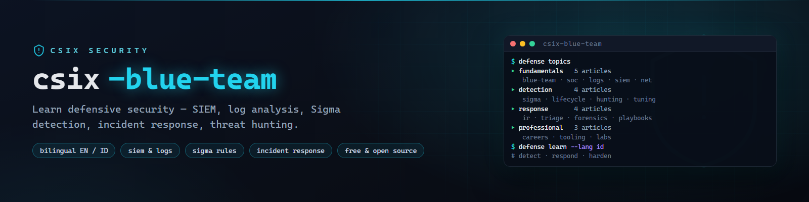

# csix-blue-team



**Basis belajar blue team gratis dua bahasa (EN/ID) — security operations, analisis log, SIEM, aturan deteksi Sigma, incident response, dan threat hunting.**

[](https://github.com/siedysoes/csix-blue-team/actions/workflows/ci.yml)
[](LICENSE)
[](https://siedysoes.github.io/csix-blue-team/)

`csix-blue-team` adalah basis pengetahuan yang terstruktur dan ramah pemula
untuk belajar operasi keamanan defensif — artikel pendek, praktis, dan saling
terhubung yang mencakup alur kerja defender lengkap dari membaca log pertama
sampai menyetel deteksi dan menjalankan incident response.

> 🌐 **Baca di web:** **https://siedysoes.github.io/csix-blue-team/**

## Isi

### Fundamental (5 artikel)

| Artikel | Yang akan Anda pelajari |
|---------|-------------------------|
| [Apa Itu Blue Team](id/fundamentals/what-is-blue-team.md) | Peran defender, purple team, lanskap tim keamanan |
| [Dasar Security Operations](id/fundamentals/security-operations.md) | Tugas SOC, antrean alert, metrik, realita on-call |
| [Sumber Log yang Penting](id/fundamentals/log-sources.md) | Windows Event Log, syslog, EDR, cloud audit log — apa yang dikumpulkan |
| [Dasar SIEM](id/fundamentals/siem-basics.md) | Cara kerja SIEM, ingestion, korelasi, ikhtisar Splunk/ELK/Wazuh |
| [Pertahanan Jaringan](id/fundamentals/network-defense.md) | Firewall, IDS/IPS, segmentasi, DNS filtering, NetFlow |

### Rekayasa Deteksi (4 artikel)

| Artikel | Yang akan Anda pelajari |
|---------|-------------------------|
| [Menulis Aturan Sigma](id/detection/sigma-rules.md) | Sintaks deteksi netral-vendor, contoh rule lengkap, pengujian |
| [Siklus Deteksi](id/detection/detection-lifecycle.md) | Hipotesis → rule → uji → deploy → tuning → pensiun |
| [Threat Hunting](id/detection/threat-hunting.md) | Berburu berbasis hipotesis, pemetaan MITRE ATT&CK |
| [Tuning & False Positive](id/detection/false-positives.md) | Meredam noise, baselining, severity yang menggerakkan aksi |

### Respons Insiden (4 artikel)

| Artikel | Yang akan Anda pelajari |
|---------|-------------------------|
| [Proses Incident Response](id/response/incident-response.md) | Persiapan → deteksi → containment → eradication → lessons |
| [Triage Alert](id/response/triage-alerts.md) | Bekerja dengan antrean, enrichment, eskalasi vs tutup |
| [Dasar Digital Forensics](id/response/forensics-basics.md) | Penanganan bukti, artefak disk/memori, membangun timeline |
| [Playbook & Checklist](id/response/playbooks.md) | Menulis playbook yang berulang, checklist IR, komunikasi |

### Praktik Profesional (3 artikel)

| Artikel | Yang akan Anda pelajari |
|---------|-------------------------|
| [Karier & Sertifikasi Blue Team](id/professional/blue-team-career.md) | Jalur SOC L1 → analis, Security+, CySA+, BTL1 |
| [Tool Pertahanan](id/professional/defense-tooling.md) | Wazuh, Velociraptor, Suricata, OSQuery — toolkit gratis |
| [Lab & Range Pertahanan](id/professional/defense-labs.md) | Membangun SOC lab di rumah, range, CTF defensif |

Setiap artikel tersedia dalam **English** (`en/`) dan **Bahasa Indonesia** (`id/`).

## Baca di web

Situsnya adalah aplikasi statis satu halaman (tanpa server, tanpa pelacakan)
yang dijalankan GitHub Pages — merender file Markdown dari repo ini secara langsung:

- 🌐 **https://siedysoes.github.io/csix-blue-team/**
- Tombol ganti bahasa **EN ↔ ID** di bar atas
- Kotak pencarian memfilter topik saat Anda mengetik
- Link di dalam artikel navigasi tanpa reload halaman

## Struktur repositori

```
csix-blue-team/
├── index.html        # cangkang aplikasi web
├── app.js            # router + pencarian + ganti bahasa
├── style.css         # tema gelap
├── topics.json       # manifest topik (judul + jalur, EN/ID)
├── assets/           # banner
├── en/               # artikel English
│   ├── fundamentals/
│   ├── detection/
│   ├── response/
│   └── professional/
├── id/               # artikel Indonesia
│   ├── fundamentals/
│   ├── detection/
│   ├── response/
│   └── professional/
└── .github/workflows # CI: validasi link + manifest
```

## Berlatih dengan aman

- Bangun lab di VM terisolasi; gunakan
  [panduan home lab CSIX Wiki](https://siedysoes.github.io/csix-wiki/#/en/practical/hands-on-lab).
- Konten deteksi di sini untuk membela sistem yang Anda miliki atau berwenang
  melindunginya. Playbook dan prosedur berubah seiring waktu — cocokkan detail
  terkini dengan dokumentasi resmi vendor.

## Berkontribusi

1. Fork, lalu tambah/ubah Markdown di `en/` (dan terjemahkan di `id/`).
2. Daftarkan topik baru di `topics.json` (kedua bahasa).
3. Buka pull request — CI memastikan semua link dan entri manifest valid.

Gaya artikel: Markdown murni, tanpa front matter, baris pertama `# Judul`,
diakhiri satu bagian `## Lihat juga` berisi link relatif.

## Bahasa

- [English](README.md)
- Bahasa Indonesia (file ini)

## Lisensi

MIT — lihat [LICENSE](LICENSE). Konten bebas dipelajari, dibagikan, dan
diadaptasi dengan atribusi.
