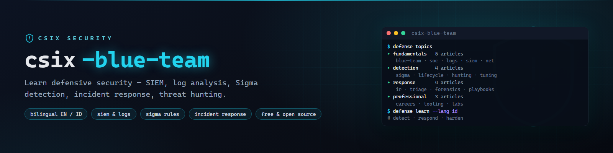

# csix-blue-team



**Free bilingual (EN/ID) blue team learning base — security operations, log analysis, SIEM, Sigma detection rules, incident response, and threat hunting.**

[](https://github.com/siedysoes/csix-blue-team/actions/workflows/ci.yml)
[](LICENSE)
[](https://siedysoes.github.io/csix-blue-team/)

`csix-blue-team` is a structured, beginner-friendly knowledge base for learning
defensive security operations — short, practical, cross-linked articles covering
the full defender workflow from reading your first log to tuning detections and
running incident response.

> 🌐 **Read it on the web:** **https://siedysoes.github.io/csix-blue-team/**

## What's inside

### Fundamentals (5 articles)

| Article | You'll learn |
|---------|--------------|
| [What Is a Blue Team](en/fundamentals/what-is-blue-team.md) | Defender roles, purple teaming, the security team landscape |
| [Security Operations Fundamentals](en/fundamentals/security-operations.md) | SOC duties, alert queues, metrics, on-call reality |
| [Log Sources That Matter](en/fundamentals/log-sources.md) | Windows Event Logs, syslog, EDR, cloud audit logs — what to collect |
| [SIEM Basics](en/fundamentals/siem-basics.md) | What a SIEM does, ingestion, correlation, Splunk/ELK/Wazuh overview |
| [Network Defense](en/fundamentals/network-defense.md) | Firewalls, IDS/IPS, segmentation, DNS filtering, NetFlow |

### Detection Engineering (4 articles)

| Article | You'll learn |
|---------|--------------|
| [Writing Sigma Rules](en/detection/sigma-rules.md) | Vendor-neutral detection syntax, full example rules, testing |
| [The Detection Lifecycle](en/detection/detection-lifecycle.md) | Hypothesis → rule → test → deploy → tune → retire |
| [Threat Hunting](en/detection/threat-hunting.md) | Hypothesis-driven hunts, MITRE ATT&CK mapping, hypotheses |
| [Tuning & False Positives](en/detection/false-positives.md) | Reducing noise, baselining, severity that drives action |

### Incident Response (4 articles)

| Article | You'll learn |
|---------|--------------|
| [Incident Response Process](en/response/incident-response.md) | Preparation → detection → containment → eradication → lessons |
| [Alert Triage](en/response/triage-alerts.md) | Working the queue, enriching, deciding escalate vs close |
| [Digital Forensics Basics](en/response/forensics-basics.md) | Evidence handling, disk/memory artifacts, timeline building |
| [Playbooks & Checklists](en/response/playbooks.md) | Writing repeatable playbooks, IR checklists, communication |

### Professional Practice (3 articles)

| Article | You'll learn |
|---------|--------------|
| [Blue Team Careers & Certs](en/professional/blue-team-career.md) | SOC L1→analyst paths, Security+, CySA+, BTL1 compared |
| [Defense Tooling](en/professional/defense-tooling.md) | Wazuh, Velociraptor, Suricata, OSQuery — free toolkit |
| [Defense Labs & Ranges](en/professional/defense-labs.md) | Building a home SOC lab, ranges, defensive CTFs |

Every article exists in **English** (`en/`) and **Indonesian** (`id/`).

## Read on the web

The site is a static single-page app (no server, no tracking) served by
GitHub Pages — it renders the Markdown files from this repo live:

- 🌐 **https://siedysoes.github.io/csix-blue-team/**
- Language toggle **EN ↔ ID** in the top bar
- Search box filters topics as you type
- In-article links navigate without page reloads

## Repository layout

```
csix-blue-team/
├── index.html        # web app shell
├── app.js            # router + search + language toggle
├── style.css         # dark theme
├── topics.json       # topic manifest (titles + paths, EN/ID)
├── assets/           # banner
├── en/               # English articles
│   ├── fundamentals/
│   ├── detection/
│   ├── response/
│   └── professional/
├── id/               # Indonesian articles
│   ├── fundamentals/
│   ├── detection/
│   ├── response/
│   └── professional/
└── .github/workflows # CI: link + manifest validation
```

## Practice safely

- Build your lab on isolated VMs; use the
  [CSIX Wiki home lab guide](https://siedysoes.github.io/csix-wiki/#/en/practical/hands-on-lab).
- Detection content here is for defending systems you own or are authorized to
  protect. Playbooks and procedures change over time — verify current details
  against official vendor documentation.

## Contribute

1. Fork and add/edit Markdown under `en/` (and translate under `id/`).
2. Register new topics in `topics.json` (both languages).
3. Open a pull request — CI checks that all links and manifest entries resolve.

Article style: pure Markdown, no front matter, `# Title` first line,
one `## See also` section with relative links at the end.

## Languages

- English (this file)
- [Bahasa Indonesia](README.id.md)

## License

MIT — see [LICENSE](LICENSE). Content is free to learn from, share, and adapt
with attribution.
